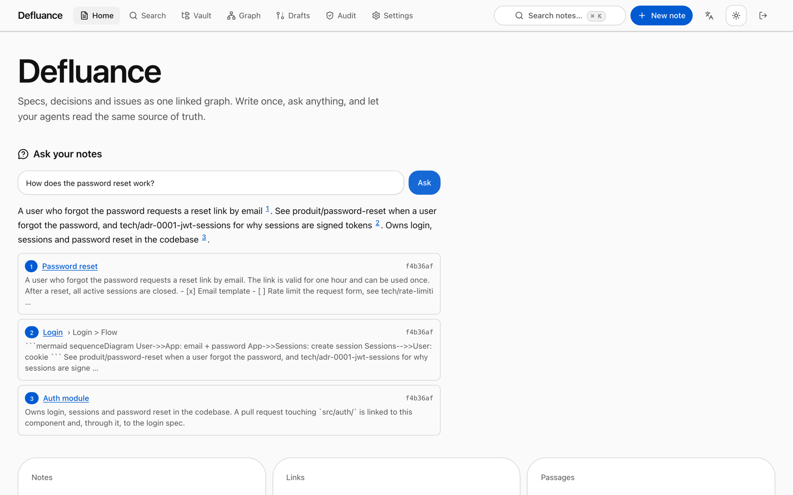
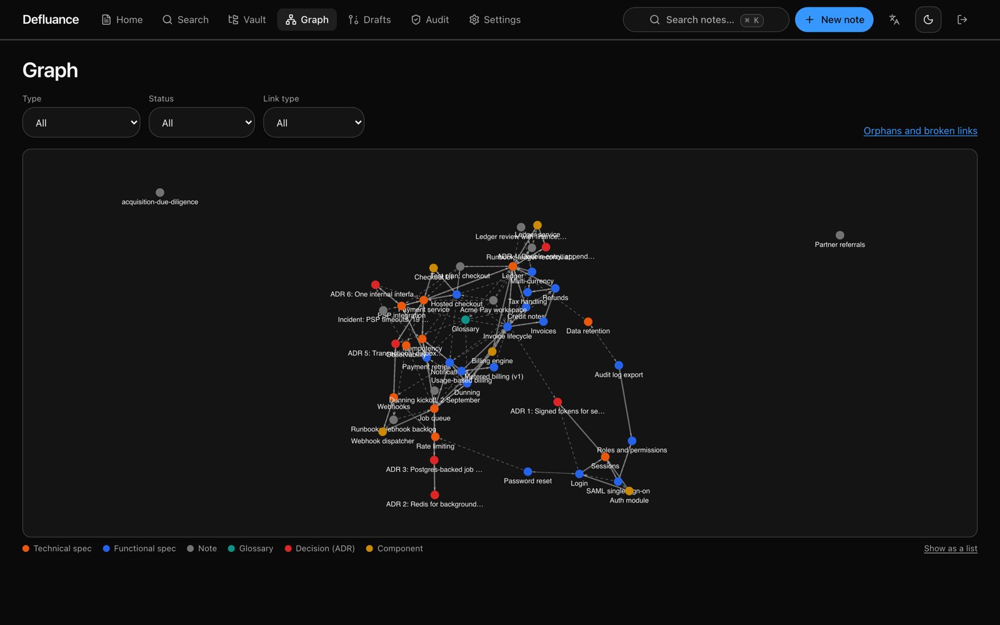
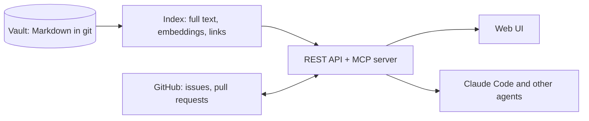

# Defluance

**Specs, decisions and issues as one linked graph, for your team and your AI agents.**

[](LICENSE)


Defluance turns a folder of Markdown notes (an Obsidian vault works as is) into a typed knowledge graph. People use it through a web UI; AI agents use the same knowledge through a REST API and an MCP server. Every answer cites the notes it came from.

<picture>
  <source media="(prefers-color-scheme: dark)" srcset="docs/images/ask-dark.png">
  
</picture>

## Why

Specs drift away from the code, decisions get lost in chat threads, and AI agents guess because they cannot see either. Defluance keeps all of it in plain Markdown under git, links it with typed relationships, and gives humans and agents one source of truth to read from and write to.

## Features

- **Ask your notes (RAG).** Full-text and semantic search with embeddings (local, Ollama or OpenAI), and LLM answers grounded in the matching passages, with numbered citations. "Research in depth" follows links for questions that span several specs.
- **Typed knowledge graph.** Functional specs, technical specs, decisions (ADR), components and glossary entries, linked by `implements`, `depends_on`, `supersedes`, `tested_by`, `tracked_by`, `blocks` and `related`.
- **Built for AI agents.** An MCP server with 11 tools. Agents such as Claude Code read the graph and write drafts on a branch; they cannot approve, and every action lands in the audit log.
- **GitHub sync.** Issues and pull requests become graph nodes. Open an issue from a spec; a merged pull request moves its specs from `approved` to `implemented`.
- **Team editing.** Several people edit the same note live. Private notes are encrypted for the people you choose.
- **No lock-in.** One process, SQLite or Postgres, a Docker image and Prometheus metrics. Delete Defluance and your notes are still Markdown in git.



## How it works



## Quick start

You need Node.js 22.13 or later, pnpm and git.

```bash
git clone https://github.com/9clg6/defluance.git
cd defluance
pnpm install
pnpm build
pnpm demo        # a populated demo vault on http://127.0.0.1:4000
```

To run it on your own notes:

```bash
node packages/cli/dist/bin.js init ./my-notes       # schema, templates, git repository (skip for an existing vault)
node packages/cli/dist/bin.js validate ./my-notes   # schema, links, orphans; exits 1 on errors, so it fits CI
node packages/cli/dist/bin.js serve ./my-notes      # UI, API and MCP on http://127.0.0.1:4000
```

The first start prints a one-time sign-in link. From there:

- **Search by meaning:** `defluance models install`, then start with `DFL_EMBED=local`. It runs on your machine. See [Search](docs/guide-search.md).
- **Get written answers:** set `DFL_LLM` (for example `anthropic:claude-sonnet-5-5`).
- **Connect Claude Code:** Settings, API tokens, create a token, copy the command it shows. See [Agents and MCP](docs/guide-mcp.md).
- **Connect GitHub:** Settings, GitHub. See [GitHub connector](docs/guide-github.md).
- **Deploy for a team:** Docker Compose with Postgres. See [Deployment and operations](docs/guide-deploy.md).

## Configuration

| Variable | Purpose |
|----------|---------|
| `DFL_EMBED` | `hash` (words only, default), `local` (meaning, on your machine), `ollama:<model>`, `openai:<model>`, `openai-compatible:<model>` |
| `DFL_LLM` | `anthropic:<model>`, `openai:<model>`, `openrouter:<model>`, `ollama:<model>`, `gateway:<provider/model>`. Unset: answers are the matching passages |
| `DFL_DATABASE_URL` | Postgres URL. Unset: SQLite in the data folder |
| `DFL_ADMIN_TOKEN` | A fixed admin token (Docker). Otherwise one is generated on first start |
| `DFL_ADMINS`, `DFL_DEFAULT_ROLE` | GitHub logins that are admins, and the role everyone else gets (`reader`, `editor`) |
| `GITHUB_*` | GitHub App and OAuth credentials, see [GitHub connector](docs/guide-github.md) |

See [`.env.example`](.env.example) and [Deployment and operations](docs/guide-deploy.md) for the rest.

## Documentation

The `docs/` folder is itself a Defluance vault, validated in CI.

- [Getting started](docs/guide-getting-started.md)
- [Search: words, meaning, smart, in depth](docs/guide-search.md)
- [Agents and MCP](docs/guide-mcp.md)
- [GitHub connector](docs/guide-github.md)
- [Editor](docs/guide-editor.md), [live editing](docs/guide-live-editing.md) and [private notes](docs/guide-private-notes.md)
- [Deployment and operations](docs/guide-deploy.md)
- [REST API](docs/guide-api.md), also served as OpenAPI at `/api/v1/openapi.json`
- [Security model](docs/guide-security.md)
- Design documents, in French: [vault format](docs/vault-format.md), [product brief](docs/product-brief-defluance-2026-10-02.md), [PRD](docs/prd-defluance-2026-10-02.md), [architecture](docs/architecture-defluance-2026-10-02.md)

## Development

A pnpm and Turborepo monorepo in TypeScript.

| Package | Role |
|---------|------|
| `packages/shared` | Shared types and helpers |
| `packages/vault-core` | Vault format, frontmatter, git |
| `packages/indexer` | SQLite and Postgres, search, graph, jobs |
| `packages/ai` | Embedding and LLM providers, cited answers |
| `packages/server` | REST API, MCP server, auth, GitHub |
| `packages/cli` | The `defluance` command |
| `apps/web` | Next.js web UI |

```bash
pnpm test                                  # 200+ unit and integration tests
pnpm --filter @defluance/web e2e           # browser tests with accessibility checks (needs Chrome)
pnpm --filter @defluance/e2e test:e2e      # the same flows on Chromium, Firefox, WebKit and a phone
pnpm bench                                 # 10,000-note performance benchmark
```

## License

Defluance is **source-available**, not open source, under the [PolyForm Noncommercial License 1.0.0](LICENSE).

- Personal use, hobby projects, study and research are free.
- Use inside a company or for profit, including internal team use, needs a commercial license: see [COMMERCIAL.md](COMMERCIAL.md).
