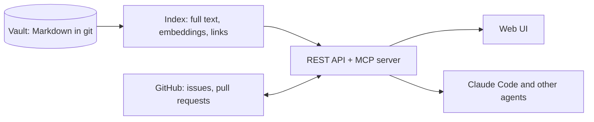

# Defluance

Specs, decisions and issues as **one linked graph**, for your team and your AI agents.

Defluance reads a folder of Markdown notes (an Obsidian vault works as is), links them with typed relationships, keeps them in sync with GitHub, and exposes the same knowledge to people (web UI) and to AI agents (REST API and an MCP server). Every answer it gives cites the notes it came from.

```bash
npx defluance serve ./my-notes
```

Open the address it prints. The first start prints a one-time sign-in link.

## What you get

| For | What |
|-----|------|
| Product and engineering | Functional specs, technical specs, decisions (ADR), components and glossary as notes, linked by `implements`, `depends_on`, `supersedes`, `tested_by`, `tracked_by`, `blocks`, `related` |
| Everyone | Search by words, by meaning (any language) or with a language model in front, a graph view, history with diffs, an editor that commits, answers with citations |
| Teams | Several people edit the same note at once and see each other, with nothing else to run ([live editing](docs/guide-live-editing.md)). Specs that must stay private are encrypted for the people you choose ([private notes](docs/guide-private-notes.md)) |
| GitHub | Issues and pull requests are nodes of the graph. Open an issue from a spec. A merged pull request moves its specs from `approved` to `implemented`. See which specs a pull request touches |
| AI agents | A [Model Context Protocol](https://modelcontextprotocol.io) server with 11 tools. Agents write drafts on a branch and cannot approve, every action is in the audit log |
| Operators | One process, SQLite or Postgres, Docker image, Prometheus metrics, no lock-in: delete Defluance and your notes are still plain Markdown in git |



## Quick start

You need Node.js 22.13 or later and git.

```bash
npx defluance init ./my-notes          # schema, templates, git repository (skip for an existing vault)
npx defluance new functional-spec "Password reset" --vault ./my-notes --owner you
npx defluance validate ./my-notes      # schema, links, orphans. Exit code 1 on errors, so it fits CI
npx defluance serve ./my-notes         # UI, API and MCP on http://127.0.0.1:4000
```

Then:

- **Ask a question** on the home page. With no language model configured you get the matching passages with sources. Set `DFL_LLM` for written answers, and tick "Research in depth" for questions that span several specs.
- **Search by meaning**: `npx defluance models install`, then `DFL_EMBED=local`. It runs on your machine. See [Search](docs/guide-search.md).
- **Connect Claude Code**: Settings, API tokens, create a token, copy the command it shows. See [Agents and MCP](docs/guide-mcp.md).
- **Connect GitHub**: Settings, GitHub walks you through it. See [GitHub connector](docs/guide-github.md).
- **Deploy for a team**: [Deployment and operations](docs/guide-deploy.md) (Docker Compose with Postgres).

## Documentation

The `docs/` folder is itself a Defluance vault, validated in CI.

- [Getting started](docs/guide-getting-started.md)
- [Vault format](docs/vault-format.md): notes, frontmatter, typed links
- [Search: words, meaning, smart, in depth](docs/guide-search.md)
- [Agents and MCP](docs/guide-mcp.md)
- [GitHub connector](docs/guide-github.md)
- [Deployment and operations](docs/guide-deploy.md)
- [REST API](docs/guide-api.md), also served as OpenAPI at `/api/v1/openapi.json`
- [Security model](docs/guide-security.md)
- Design: [product brief](docs/product-brief-defluance-2026-10-02.md), [PRD](docs/prd-defluance-2026-10-02.md), [architecture](docs/architecture-defluance-2026-10-02.md), [sprint plan](docs/sprint-plan-defluance-2026-10-02.md)

## Configuration at a glance

| Variable | Purpose |
|----------|---------|
| `DFL_EMBED` | `hash` (words only, default), `local` (meaning, on your machine), `ollama:<model>`, `openai:<model>`, `openai-compatible:<model>` |
| `DFL_LLM` | `anthropic:<model>`, `openai:<model>`, `openrouter:<model>`, `ollama:<model>`, `gateway:<provider/model>`. Unset: answers are the matching passages |
| `DFL_DATABASE_URL` | Postgres URL. Unset: SQLite in the data folder |
| `DFL_ADMIN_TOKEN` | A fixed admin token (Docker). Otherwise one is generated on first start |
| `DFL_ADMINS`, `DFL_DEFAULT_ROLE` | GitHub logins that are admins, and the role everyone else gets (`reader`, `editor`) |
| `GITHUB_*` | GitHub App and OAuth credentials, see [GitHub connector](docs/guide-github.md) |

Everything else is in [Deployment and operations](docs/guide-deploy.md).

## License

Defluance is **source-available**, not open source. It is licensed under the [PolyForm Noncommercial License 1.0.0](LICENSE):

- Personal use, hobby projects, study and research are free.
- Use inside a company or for profit, including internal team use, needs a paid commercial license: see [COMMERCIAL.md](COMMERCIAL.md).

Contributions will need a contributor license agreement so the project can keep offering commercial licenses.

## Development

```bash
pnpm install
pnpm build            # all packages and the web UI
pnpm test             # 200+ unit and integration tests
pnpm --filter @defluance/web e2e   # browser tests with accessibility checks (needs Chrome)
pnpm --filter @defluance/e2e test:e2e   # the same flows on Chromium, Firefox, WebKit and a phone, see apps/e2e
pnpm bench            # 10,000-note performance benchmark against the PRD limits
pnpm pack:cli --verify             # build the npm package and run it from a clean install
```

Packages: `shared`, `vault-core` (format, git), `indexer` (SQLite and Postgres, search, graph, jobs), `ai` (providers, cited answers), `server` (REST, MCP, auth, GitHub), `cli`, and `apps/web` (Next.js with [ObsidianUI](https://www.obsidianui.dev/)).
