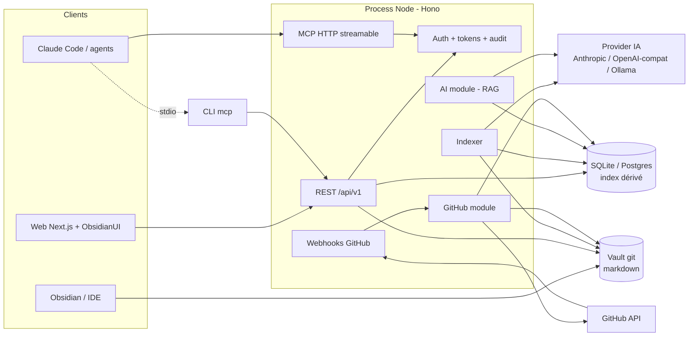

# Architecture système : Defluance

**Date :** 2026-10-02
**Architecte :** clement
**Version :** 1.0
**Type de projet :** web-app
**Niveau de projet :** 3
**Statut :** Draft

---

## Présentation du document

Plan technique de Defluance. Répond à toutes les FR et NFR du PRD.

**Documents liés :**
- PRD : docs/prd-defluance-2026-10-02.md
- Product brief : docs/product-brief-defluance-2026-10-02.md

---

## Résumé exécutif

Monolithe modulaire TypeScript en monorepo. Un dépôt git markdown (le vault) est la seule source de vérité. Un serveur Node (Hono) expose API REST, serveur MCP et webhooks GitHub, et maintient un index dérivé (SQLite en local, Postgres en serveur). Une app Next.js avec ObsidianUI consomme l'API. Une CLI couvre validation, indexation, création de fiches, lancement local et MCP stdio. Tout ce qui écrit passe par git ; tout ce qui lit passe par l'index.

---

## Drivers architecturaux

1. **NFR-004 zéro lock-in** → fichiers markdown + git comme seul stockage de contenu ; index jetable.
2. **NFR-008 compatibilité Obsidian / MCP / OpenAPI** → parser wikilinks conforme, SDK MCP officiel, OpenAPI généré depuis le code.
3. **NFR-001 / NFR-002 performance** → index local (FTS + vecteurs) co-localisé avec le serveur ; indexation incrémentale par diff git.
4. **NFR-003 sécurité** → tokens scopés hachés, signature webhooks, aucune exécution de contenu, agents en PR uniquement par défaut.
5. **FR-020 provider IA interchangeable** → abstraction via Vercel AI SDK, embeddings locaux (Ollama) possibles.
6. **FR-027 installation simple** → un process Node + une base ; Docker Compose ou `npx`.

---

## Vue d'ensemble

### Architecture haut niveau

**Pattern :** monolithe modulaire, monorepo pnpm, un seul process serveur.

**Justification :** équipe d'une personne, auto-hébergement par des équipes variées, NFR de performance atteignables sur une machine. Les modules ont des frontières nettes (packages) pour permettre une extraction ultérieure si nécessaire, sans payer la complexité microservices aujourd'hui.

**Composants :**
1. `vault-core` : parser, schéma, liens, opérations git.
2. `indexer` : chunking, FTS, embeddings, arêtes, requêtes de graphe.
3. `server` : API REST, MCP HTTP, webhooks, auth, audit, jobs.
4. `github` : GitHub App, cache issues/PR, statut dérivé, impact.
5. `ai` : provider, RAG citant.
6. `web` : Next.js + ObsidianUI.
7. `cli` : validate, index, new, serve, mcp.

### Diagramme



**Flux d'écriture :** client → API (auth, permissions) → `vault-core` écrit le fichier et commit → hook post-commit → `indexer` incrémental → audit.

**Flux de lecture :** client → API → `indexer` (DB) ; le contenu brut d'une fiche est lu depuis le vault à la révision demandée.

---

## Stack technique

### Frontend

**Choix :** Next.js 15 App Router, React 19, TypeScript, Tailwind CSS 4, ObsidianUI (composants copiés dans le dépôt, Motion pour les animations), CodeMirror 6 (éditeur markdown), react-force-graph-2d (graphe), react-markdown + remark-gfm + remark-wiki-link + Mermaid (rendu).

**Justification :** stack imposée par ObsidianUI ; CodeMirror 6 est l'éditeur texte le plus solide pour markdown avec autocomplétion ; react-force-graph suffit jusqu'à ~500 nœuds.

**Compromis :** ObsidianUI est orienté effets visuels, pas composants de formulaire ; les primitives (inputs, dialogs, tables) viennent de Radix / shadcn-style, stylées cohérentes. Si le graphe global dépasse 500 nœuds, passer à Sigma.js.

### Backend

**Choix :** Node 22+, TypeScript 6 strict (TS 7 non supporté par typescript-eslint), Hono + `@hono/zod-openapi` (REST + OpenAPI généré), `@modelcontextprotocol/sdk` (MCP stdio et HTTP streamable), `simple-git` (opérations git via binaire git), `gray-matter` + `remark` (parser), Zod (schémas), `@octokit/app` + `@octokit/webhooks` (GitHub), Vercel AI SDK (`ai`) pour génération et embeddings.

**Justification :** un seul langage sur toute la stack ; Hono est léger, typé, génère l'OpenAPI depuis Zod ; le SDK MCP officiel évite d'écrire le protocole ; `simple-git` délègue au vrai git (fiabilité, conflits, auth SSH/HTTPS).

**Compromis :** dépendance au binaire `git` dans l'image Docker (acceptable). Pas de Python : les embeddings locaux passent par Ollama, pas par un modèle embarqué.

### Base de données

**Choix :** SQLite (better-sqlite3, FTS5, sqlite-vec) en mode local ; Postgres 16 (tsvector, pgvector) en mode serveur. Drizzle ORM pour le schéma relationnel, SQL brut pour FTS et vecteurs derrière une interface `IndexStore`.

**Justification :** un vault est petit (< 10 000 fiches) ; SQLite suffit à une équipe sur une machine et rend `npx defluance serve` possible sans service externe. Postgres pour multi-instances et volumes supérieurs.

**Compromis :** deux implémentations de `IndexStore` à maintenir (≈ 300 lignes chacune). Pas de Neo4j : les requêtes de graphe sont des CTE récursives sur la table `edges`, suffisant à profondeur ≤ 5.

### Infrastructure

**Choix :** Docker Compose (server, web, postgres) pour le self-hosting ; `npx defluance serve <vault>` (SQLite, UI Next standalone embarquée) pour le local. Aucun cloud imposé.

**Justification :** FR-027 et NFR-004.

### Services tiers

- GitHub : GitHub App (webhooks, API REST), OAuth GitHub pour les humains.
- Provider IA : Anthropic, OpenAI-compatible, Ollama ; sélection par variables d'environnement.

### Développement et déploiement

- pnpm workspaces, Turborepo pour le cache de build.
- Vitest (unitaire, intégration), Playwright (E2E UI minimal), tsx pour les scripts.
- GitHub Actions : lint, typecheck, tests, benchmark index/recherche, scan dépendances, build images.
- Logs JSON (pino), métriques Prometheus (`/metrics`), `/health`.

---

## Composants

### Composant : vault-core (`packages/vault-core`)

**Rôle :** source de vérité et règles du format.

**Responsabilités :**
- Parser markdown + frontmatter (gray-matter, remark) et extraire titre, headings, wikilinks `[[cible|type]]`, liens `gh:`.
- Charger `.defluance/schema.yaml` (types de fiche, champs, types de lien, statuts) et valider une fiche (Zod généré depuis le schéma).
- Résoudre les cibles de liens (slug, chemin, alias) comme Obsidian.
- Opérations git : lire à une révision, écrire + commit, créer branche, diff entre commits, log d'un fichier, détection de conflit (compare SHA de base).
- Templates : `.defluance/templates/<type>.md`.

**Interfaces :** API TypeScript interne, utilisée par `indexer`, `server`, `cli`.

**Dépendances :** binaire git.

**FR :** FR-001, FR-002, FR-003, FR-004, FR-005, FR-026.

### Composant : indexer (`packages/indexer`)

**Rôle :** index dérivé et requêtes.

**Responsabilités :**
- Indexation complète ou incrémentale (diff entre `index_state.last_commit` et HEAD).
- Chunking par heading (max ~800 tokens, chevauchement 10 %).
- FTS (BM25) et embeddings par chunk ; fusion hybride (reciprocal rank fusion).
- Table `edges` et requêtes : voisins, chemin, impact (CTE récursive), orphelins, liens cassés.
- Interface `IndexStore` avec implémentations `SqliteStore` et `PostgresStore`.

**Interfaces :** API TypeScript interne.

**Dépendances :** `vault-core`, `ai` (embeddings), DB.

**FR :** FR-006, FR-007, FR-008, FR-018 (partie graphe).

### Composant : server (`packages/server`)

**Rôle :** façade unique.

**Responsabilités :**
- REST `/api/v1` avec OpenAPI généré.
- MCP HTTP streamable sur `/mcp` ; les outils appellent les mêmes services que REST.
- Auth : session OAuth GitHub (cookie signé) et tokens API `dfl_…` (hachés SHA-256, scopes, espaces, expiration).
- Permissions par espace (rôles `reader`, `editor`, `admin`).
- Audit : chaque écriture journalisée (acteur, outil, cible, commit).
- File de jobs en process (indexation, webhooks) avec persistance en DB pour reprise.
- Rate limiting par token.

**Interfaces :** HTTPS, MCP.

**Dépendances :** tous les packages.

**FR :** FR-010, FR-011, FR-012, FR-013, FR-014.

### Composant : github (`packages/github`)

**Rôle :** connecteur GitHub.

**Responsabilités :**
- Authentification GitHub App (JWT app + installation tokens).
- Réception et vérification des webhooks `issues`, `pull_request`, `push`, `installation`.
- Cache `gh_nodes` (issues, PR, fichiers touchés).
- Création d'issue depuis une fiche + ajout du lien `tracked_by` par commit.
- Statut dérivé : PR mergée → fiches liées `approved` → `implemented` (commit bot).
- Analyse d'impact : `tracked_by` + correspondance `paths` des fiches `component` ; commentaire optionnel sur la PR.
- Resynchronisation complète à la demande.

**Interfaces :** interne + webhook HTTP `/webhooks/github`.

**Dépendances :** `vault-core`, `indexer`, GitHub API.

**FR :** FR-009, FR-015, FR-016, FR-017, FR-018.

### Composant : ai (`packages/ai`)

**Rôle :** provider et RAG.

**Responsabilités :**
- Factory de provider depuis l'environnement (`DFL_LLM=anthropic:claude-sonnet-5-5`, `DFL_EMBED=ollama:nomic-embed-text`).
- Embeddings batchés avec cache par hash de chunk.
- `ask` : récupération hybride filtrée → reranking simple par score → génération avec consigne de citation stricte → parse des citations `[note#heading@commit]` → validation que chaque citation existe → refus si aucune.
- Jeu d'évaluation (`eval/questions.yaml`) exécutable en CI.

**Interfaces :** interne.

**Dépendances :** `indexer`, provider IA.

**FR :** FR-019, FR-020.

### Composant : web (`apps/web`)

**Rôle :** UI humaine.

**Responsabilités :**
- Pages : `/`, `/n/[slug]`, `/n/[slug]/edit`, `/n/[slug]/history`, `/graph`, `/search`, `/spaces/[space]/settings`, `/audit`, `/setup/github`.
- Palette `Cmd+K`, panneau latéral de liens typés et nœuds GitHub, vue graphe locale/globale, éditeur CodeMirror avec autocomplétion `[[`, actions depuis la fiche (statut, issue, demander, audit).
- Auth via session du serveur ; tout appel passe par `/api/v1`.

**Dépendances :** `server`.

**FR :** FR-021 à FR-026.

### Composant : cli (`packages/cli`)

**Rôle :** outil local et CI.

**Commandes :** `init`, `validate`, `index`, `new <type> <title>`, `serve <vault>`, `mcp <vault>` (stdio, in-process, sans serveur HTTP), `resync-github`.

**FR :** FR-004, FR-005, FR-006, FR-011 (stdio), FR-027.

---

## Architecture de données

### Modèle

Le contenu vit dans le vault. La base ne stocke que des dérivés et de l'état système.

**Dans le vault :**
- Fiche : fichier `.md`, frontmatter `type`, `status`, `owner`, `tags`, `links` (optionnel), champs par type (`acceptance_criteria`, `paths`, `decision`, …), corps markdown avec wikilinks.
- `.defluance/schema.yaml`, `.defluance/templates/*.md`, `.defluance/config.yaml` (espaces = dossiers, dépôts GitHub liés, mode d'écriture des agents).

**En base (dérivé) :**
- `notes` (id, path, slug, space, type, status, owner, title, tags json, frontmatter json, content_hash, head_commit, updated_at)
- `chunks` (id, note_id, heading, ordinal, content, embedding, commit)
- `edges` (id, from_note, to_ref, to_note nullable, link_type, source `body|frontmatter`, line)
- `gh_nodes` (key `owner/repo#n`, kind `issue|pr`, state, title, labels json, author, files json, merged_at, updated_at)
- `index_state` (vault, last_commit, embed_model, indexed_at)

**État système :**
- `users` (id, github_id, login, name, avatar)
- `spaces` (id, name, path_prefix, repos json)
- `memberships` (user_id, space_id, role)
- `tokens` (id, name, hash, scopes json, space_ids json, created_by, expires_at, revoked_at, last_used_at)
- `audit_log` (id, actor_type, actor_id, action, target, payload json, commit, created_at)
- `jobs` (id, kind, payload json, status, attempts, run_after)

**Relations :** `notes 1-n chunks`, `notes 1-n edges`, `edges n-1 notes|gh_nodes` (par `to_ref`), `spaces n-n users` via `memberships`.

### Conception base

- Index : `notes(slug)`, `notes(space, type, status)`, `edges(from_note, link_type)`, `edges(to_ref, link_type)`, `gh_nodes(key)`, FTS5 virtuelle sur `chunks(content, heading, title)`, index vectoriel sqlite-vec / pgvector sur `chunks.embedding`.
- `to_ref` conserve la cible textuelle ; `to_note` est résolu à l'indexation (null = lien cassé).
- Pas de suppression logique : réindexation = upsert par `path`, suppression des fiches absentes.

### Flux de données

- Écriture : API → validation schéma → écriture fichier → `git commit` (auteur = utilisateur ou `defluance-bot <token>`) → push si remote → job index incrémental (diff `last_commit..HEAD`) → audit.
- Lecture fiche : DB pour métadonnées et graphe ; contenu lu depuis git à `HEAD` (ou à `?rev=`), rendu côté client.
- Recherche : FTS top 50 + vecteurs top 50 → RRF → filtres → top 20.
- Webhook : vérification signature → job → upsert `gh_nodes` → si PR mergée, transition de statut → commit → index.

---

## Conception API

### Architecture

REST JSON sous `/api/v1`, OpenAPI 3.1 généré, erreurs `application/problem+json`, pagination par curseur. MCP sur `/mcp` (HTTP streamable) et via `defluance mcp` (stdio). Versionnement par préfixe d'URL.

### Endpoints

**Fiches**
- `GET /api/v1/notes` : liste filtrée (`space`, `type`, `status`, `tag`, `owner`, `q`).
- `POST /api/v1/notes` : créer (`type`, `title`, `space`, `body`, `frontmatter`, `message`, `mode: direct|branch`) → `{ path, commit, branch? }`.
- `GET /api/v1/notes/{slug}` : métadonnées + corps (`?rev=`).
- `PUT /api/v1/notes/{slug}` : remplacer (`base_commit` obligatoire, 409 si divergent).
- `PATCH /api/v1/notes/{slug}/status` : transition de statut.
- `GET /api/v1/notes/{slug}/links` : entrants et sortants groupés par type.
- `POST /api/v1/notes/{slug}/links` : ajouter `{ to, type }`.
- `GET /api/v1/notes/{slug}/history` : commits + diff.
- `POST /api/v1/notes/{slug}/issues` : créer une issue GitHub liée.

**Recherche et graphe**
- `GET /api/v1/search?q=&type=&status=&space=` : hybride.
- `GET /api/v1/graph/neighbors?id=&link=&direction=&depth=`.
- `GET /api/v1/graph/path?from=&to=`.
- `GET /api/v1/graph/impact?id=&depth=` et `?pr=owner/repo#n`.
- `GET /api/v1/graph/lint` : orphelins, liens cassés.

**IA**
- `POST /api/v1/ask` : `{ question, filters }` → `{ answer, citations[] }` (stream SSE optionnel).

**GitHub**
- `POST /webhooks/github`.
- `GET /api/v1/github/nodes/{owner}/{repo}/{n}`.
- `POST /api/v1/github/resync`.

**Système**
- `POST /api/v1/index/rebuild`, `GET /api/v1/index/status`.
- `GET /api/v1/audit?actor=&action=&note=&from=&to=`.
- `GET/POST/DELETE /api/v1/spaces/{id}/tokens`.
- `GET /api/v1/openapi.json`, `GET /health`, `GET /metrics`.

**Outils MCP** (mêmes services) : `search`, `read_note`, `list_notes`, `graph_neighbors`, `graph_impact`, `create_draft`, `update_note`, `link_notes`, `create_issue`, `ask`.

### Authentification et autorisation

- Humains : OAuth GitHub → session cookie signé (HttpOnly, SameSite=Lax), durée 7 jours.
- Agents : header `Authorization: Bearer dfl_…`, token haché en base, scopes `read | write | issues`, liste d'espaces, expiration.
- Autorisation : middleware résout l'acteur, l'espace de la ressource (préfixe de chemin) et le rôle ; refus 403 explicite. Les outils MCP d'écriture vérifient `write`, `create_issue` vérifie `issues`.
- Mode d'écriture agent (`.defluance/config.yaml`, `agent_write_mode: branch` par défaut) : les écritures d'un token vont sur `defluance/<token>/<slug>` + PR optionnelle ; `direct` autorisé par configuration explicite.

---

## Couverture des NFR

### NFR-001 : performance recherche et API

**Exigence :** recherche < 300 ms p95, lecture < 100 ms p95, 10 000 fiches, 2 vCPU / 4 Go.

**Solution :** index co-localisé, FTS5/tsvector natif, vecteurs via extension native, top-k limité à 50 par branche avant fusion, métadonnées en DB (pas de lecture git pour les listes), contenu lu depuis git uniquement sur la page fiche avec cache LRU par (path, commit).

**Validation :** `pnpm bench` sur un vault synthétique de 10 000 fiches, seuils en CI.

### NFR-002 : performance indexation

**Exigence :** complet < 10 min, incrémental < 5 s.

**Solution :** diff git entre commits pour l'incrémental ; embeddings batchés (64 chunks) avec cache par hash de contenu (un chunk inchangé n'est jamais ré-embeddé) ; FTS et arêtes recalculés par fiche touchée seulement.

**Validation :** benchmark CI.

### NFR-003 : sécurité

**Solution :** secrets en env ; tokens hachés ; signature HMAC des webhooks vérifiée avant parsing ; rate limit par token (token bucket en mémoire, Postgres pour multi-instances) ; markdown rendu avec sanitisation (rehype-sanitize), pas d'HTML brut ; Mermaid en mode strict ; aucune évaluation de contenu du vault ; dépendances scannées (`pnpm audit`, Dependabot) ; headers sécurité (CSP, HSTS).

**Validation :** tests d'intégration auth et webhooks ; scan CI.

### NFR-004 : zéro lock-in

**Solution :** aucun contenu en base ; `.defluance/` versionné et documenté ; `docs/vault-format.md` est la spec publique ; test de conformité : un vault Obsidian de référence est parsé sans erreur et chaque wikilink résolu comme Obsidian.

**Validation :** suite de conformité en CI.

### NFR-005 : fiabilité

**Solution :** une écriture est confirmée seulement après commit réussi ; jobs persistés en DB avec reprise ; indexation idempotente (upsert) ; `index/rebuild` reconstruit tout ; webhooks manqués récupérés par `github/resync` (liste des issues/PR modifiées depuis `updated_at` max).

**Validation :** test « kill pendant indexation puis relance ».

### NFR-006 : accessibilité et navigateurs

**Solution :** primitives accessibles (Radix) sous les styles ObsidianUI ; `prefers-reduced-motion` respecté par Motion (`useReducedMotion`) ; thème via `prefers-color-scheme` + bascule ; audit axe dans Playwright.

**Validation :** Playwright + axe sans erreur critique sur lecture, recherche, édition.

### NFR-007 : maintenabilité

**Solution :** TypeScript strict, ESLint, Vitest ; couverture ≥ 70 % sur `vault-core`, `indexer`, auth ; tests d'intégration API et MCP sur vault de fixtures ; CI requise pour merge.

### NFR-008 : standards

**Solution :** remark (CommonMark + GFM) + plugin wikilink conforme Obsidian (alias, headings `#`, blocs `^`) ; OpenAPI généré depuis Zod ; SDK MCP officiel ; AI SDK comme interface provider.

### NFR-009 : internationalisation

**Solution :** `next-intl`, fichiers `en.json`, `fr.json`, défaut `en`.

### NFR-010 : observabilité

**Solution :** pino JSON, `/metrics` Prometheus (latence par route, appels MCP par outil, taille index, webhooks reçus/échoués, jobs en attente), `/health` (git, DB, provider IA), dashboard Grafana JSON fourni dans `deploy/`.

---

## Sécurité

### Authentification
OAuth GitHub (Auth.js côté web, validation de session côté serveur par cookie signé). Tokens API préfixés `dfl_`, affichés une fois, hachés SHA-256, expiration par défaut 90 jours.

### Autorisation
RBAC par espace : `reader` (lecture, recherche, ask), `editor` (+ écriture, liens, statut, issues), `admin` (+ tokens, membres, dépôts). Tokens limités par scopes et espaces. Vault sans config = espace `default`, tous `editor`.

### Chiffrement
TLS terminé par le reverse proxy (Caddy fourni dans Compose). Secrets jamais en base. Base chiffrée au repos à la charge de l'hébergeur.

### Bonnes pratiques
Validation Zod sur toutes les entrées ; requêtes paramétrées ; sanitisation du rendu markdown ; CSRF par SameSite + vérification d'origine sur les mutations ; rate limiting ; journal d'audit non modifiable via API ; agents en mode `branch` par défaut.

---

## Scalabilité et performance

**Scaling :** vertical d'abord. Multi-instances possible en mode Postgres : vault partagé via remote git (chaque instance clone, push/pull), jobs en DB, rate limit en DB. Pas de ciblage au-delà de 50 000 fiches en v1.

**Optimisations :** index DB ciblés, cache LRU du contenu de fiche, embeddings cachés par hash, graphe local limité par profondeur et taille, pagination par curseur.

**Cache :** LRU en process (contenu par commit, résultats de `graph/neighbors` 30 s). Pas de Redis.

**Load balancing :** reverse proxy Caddy ; plusieurs instances derrière en mode Postgres si besoin.

---

## Fiabilité et disponibilité

**HA :** non visée en v1 (outil d'équipe self-hosted). Reprise rapide : état entièrement reconstructible depuis git + GitHub.

**DR :** RPO = dernier commit poussé ; RTO = temps de `docker compose up` + réindexation (< 10 min pour 10 000 fiches).

**Sauvegardes :** le remote git est la sauvegarde du contenu ; dump Postgres quotidien optionnel pour audit, tokens, membres.

**Monitoring :** `/health`, `/metrics`, alertes Grafana sur erreurs webhooks, jobs en échec, latence p95.

---

## Intégrations

**Externes :** GitHub (App, OAuth, webhooks, REST), providers IA via AI SDK (Anthropic, OpenAI-compatible, Ollama).

**Internes :** packages du monorepo via imports TypeScript ; MCP stdio appelle les services in-process (pas de HTTP).

**Événements :** file de jobs persistée en DB (`jobs`), un worker in-process, kinds : `index.incremental`, `index.full`, `github.webhook`, `github.resync`, `status.derive`, `embed.batch`. Retry exponentiel, 5 tentatives.

---

## Architecture de développement

### Organisation du code

```
defluance/
  apps/web/                 Next.js + ObsidianUI
  packages/vault-core/      parser, schéma, git
  packages/indexer/         stores SQLite/Postgres, recherche, graphe
  packages/server/          Hono, REST, MCP, auth, audit, jobs
  packages/github/          App, webhooks, cache, statut, impact
  packages/ai/              provider, RAG, eval
  packages/cli/             commandes
  packages/shared/          types Zod, erreurs, config
  deploy/                   docker-compose.yml, Caddyfile, grafana/
  docs/                     BMAD + vault-format.md (le vault de Defluance lui-même)
  fixtures/vault-obsidian/  vault de conformité
```

Le dépôt Defluance utilise son propre `docs/` comme vault (dogfooding).

### Tests

- Unitaires (Vitest) : parser, wikilinks, schéma, chunking, RRF, CTE graphe, auth, scopes.
- Intégration : API et MCP contre un vault de fixtures + SQLite en mémoire ; webhooks avec payloads enregistrés.
- E2E (Playwright) : lecture, recherche, édition + commit, création d'issue (GitHub mocké).
- Benchmarks : index et recherche sur vault synthétique.
- Évaluation RAG : 30 questions, 100 % citations valides.

### CI/CD

GitHub Actions : `lint` → `typecheck` → `test` → `bench` (seuils) → `eval-rag` (nightly, provider local) → `build` images → `release` (tags semver, images GHCR, package npm `defluance`).

### Environnements

- `local` : `npx defluance serve`, SQLite, Ollama optionnel.
- `self-hosted` : Docker Compose, Postgres, Caddy.
- Config par env : `DFL_VAULT_PATH`, `DFL_VAULT_REMOTE`, `DFL_DB_URL`, `DFL_LLM`, `DFL_EMBED`, `GITHUB_APP_ID`, `GITHUB_PRIVATE_KEY`, `GITHUB_WEBHOOK_SECRET`, `GITHUB_OAUTH_*`, `DFL_SESSION_SECRET`.

### Déploiement

Rolling simple : `docker compose pull && up -d`. Migrations Drizzle au démarrage. Index reconstruit si `embed_model` change.

---

## Traçabilité

### FR → composants

| FR | Composants |
|----|------------|
| FR-001 vault source de vérité | vault-core, server |
| FR-002 schéma | vault-core, shared |
| FR-003 liens typés | vault-core, indexer |
| FR-004 validate CLI | cli, vault-core |
| FR-005 templates | vault-core, cli, web |
| FR-006 indexeur | indexer, ai |
| FR-007 recherche | indexer, server |
| FR-008 graphe | indexer, server |
| FR-009 statut dérivé | github, vault-core |
| FR-010 REST OpenAPI | server |
| FR-011 MCP | server, cli |
| FR-012 auth tokens | server |
| FR-013 audit | server |
| FR-014 espaces | server, shared |
| FR-015 GitHub App | github, server |
| FR-016 nœuds GitHub | github, indexer |
| FR-017 issue depuis fiche | github, server, web |
| FR-018 impact PR | github, indexer |
| FR-019 ask citant | ai, server |
| FR-020 provider | ai |
| FR-021 lecture | web |
| FR-022 recherche UI | web |
| FR-023 graphe UI | web |
| FR-024 édition | web, server, vault-core |
| FR-025 actions fiche | web, server |
| FR-026 historique | web, vault-core |
| FR-027 installation | cli, deploy |

### NFR → solutions

| NFR | Solution | Validation |
|-----|----------|------------|
| NFR-001 | index co-localisé, FTS + vecteurs natifs, cache LRU | bench CI |
| NFR-002 | diff git, cache embeddings par hash | bench CI |
| NFR-003 | tokens hachés, HMAC webhooks, sanitisation, rate limit | tests intégration, scan |
| NFR-004 | zéro contenu en base, spec publique, vault de conformité | suite conformité |
| NFR-005 | commit avant ack, jobs persistés, resync | test crash/reprise |
| NFR-006 | Radix + reduced motion + axe | Playwright |
| NFR-007 | TS strict, Vitest, couverture 70 % | CI |
| NFR-008 | remark wikilink, OpenAPI Zod, SDK MCP, AI SDK | conformité |
| NFR-009 | next-intl | revue |
| NFR-010 | pino, Prometheus, /health | dashboard |

---

## Compromis et décisions

**D1. Monolithe modulaire plutôt que services.** Gain : simplicité d'installation et de dev. Perte : scaling indépendant. Justifié par la cible (équipes, self-hosted).

**D2. Git réel via `simple-git` plutôt qu'isomorphic-git.** Gain : fiabilité, auth, conflits gérés par git. Perte : binaire git requis.

**D3. CTE récursives plutôt que Neo4j.** Gain : une seule base, zéro service. Perte : requêtes de graphe complexes limitées. Export Neo4j possible plus tard.

**D4. SQLite et Postgres via interface `IndexStore`.** Gain : local sans service, serveur robuste. Perte : double implémentation.

**D5. AI SDK comme abstraction provider.** Gain : Anthropic, OpenAI-compatible, Ollama sans code spécifique. Perte : dépendance à l'évolution du SDK.

**D6. Agents en mode `branch` par défaut.** Gain : contrôle humain. Perte : friction pour les drafts triviaux. `direct` activable par espace.

**D7. ObsidianUI pour l'identité visuelle, Radix pour les primitives.** Gain : esthétique voulue + accessibilité. Perte : deux sources de composants à harmoniser.

**D8. Vault = n'importe quel dépôt git + sous-chemin.** Documenté d'abord avec un dépôt dédié ; vault dans `docs/` du dépôt de code supporté et utilisé en dogfooding.

**D9. CLI `serve` embarque le build Next standalone.** Gain : `npx` sans Docker. Perte : package npm lourd (~30 Mo).

---

## Questions ouvertes et risques

- Qualité du reranking sans modèle dédié : évaluer sur le jeu de 30 questions, ajouter un reranker si < 90 % de pertinence.
- Multi-instances et push concurrent sur le vault : v1 une instance d'écriture ; verrou DB sur les écritures git si multi-instances.
- Licence tranchée : PolyForm Noncommercial 1.0.0 + licence commerciale. CLA nécessaire pour accepter des contributions externes tout en gardant le droit de relicencier.
- Taille du graphe global dans l'UI : basculer vers Sigma.js si > 500 nœuds affichés.

---

## Écarts d'implémentation (version 0.1)

Ce que le code fait réellement, quand il diffère du plan ci-dessus. Chaque écart a un plafond connu et un chemin d'évolution.

| Prévu | Réalisé | Pourquoi, plafond, évolution |
|-------|---------|------------------------------|
| SQLite via better-sqlite3 + sqlite-vec | `node:sqlite` intégré à Node (22.13 ou plus), FTS5 | Aucune compilation native : le module natif cassait déjà au premier essai. Recherche vectorielle faite en mémoire |
| pgvector en Postgres | Vecteurs en `BYTEA`, cosinus calculé en mémoire, plein texte `tsvector` | Un seul code de recherche vectorielle pour les deux bases. Plafond : environ 50 000 passages en RAM. Évolution : pgvector ou sqlite-vec derrière `IndexStore` |
| Graphe par CTE récursives | Arêtes résolues chargées en mémoire, parcours en JavaScript, cache par version d'index | Plus simple, 0,7 ms pour un voisinage de profondeur 2 sur 10 000 notes. Plafond : environ 100 000 arêtes |
| Package `github` séparé | Module dans `packages/server/src/github` | Il écrit dans le vault, indexe et audite : il partage les services d'écriture. Les échanges avec GitHub passent par `fetch` et `node:crypto`, sans Octokit |
| Next.js standalone | Export statique servi par le serveur | Un seul processus, un seul port, `npx defluance serve` sans Docker. Les pages de fiche sont rendues côté client (`/n/*` sert une page unique) |
| Node 24 | Node 22.13 ou plus | Version installée. `node:sqlite` stable sans drapeau à partir de 22.13 |
| pino | Logs JSON sur stdout, sans dépendance | Même contenu, moins de dépendances |
| Reranker du RAG | Aucun | Citations validées structurellement : une citation est toujours un passage récupéré. Réponse extractive sans LLM, refus sans source |
| Embeddings via le seul AI SDK | Embedder `local` en plus : `@huggingface/transformers`, installé à la demande dans `~/.defluance/runtime`, modèle multilingue MiniLM quantifié | Recherche par le sens sans service ni clé. Le runtime pèse 480 Mo : jamais dans le paquet de base. Passages découpés en fenêtres de 85 mots (le modèle lit 128 jetons) et moyennés |
| Une page graphe par type de lien | `react-force-graph-2d`, liste accessible en doublon | Canvas non lisible par un lecteur d'écran |
| Éditeur à un seul auteur | Édition à plusieurs en direct (D23) et brouillon d'agent relu dans l'interface | Demande de l'utilisateur après la 0.1 |
| Interface ObsidianUI seule | Arc UI (uiarc.dev, MIT) copié dans `components/arc`, jetons préfixés `--arc-` et ramenés à notre palette (gris neutres, un bleu, couleurs de statut pleines : ni violet ni pastel), foyer visible rétabli | Un script d'import rend la copie reproductible ; les correctifs sont listés dans `scripts/arc-import.mjs` |
| Headers de sécurité (NFR-003) | CSP, `nosniff`, referrer policy, HSTS en https, via `hono/secure-headers` (ajoutés après audit : la première version ne les envoyait pas, alors que ce document les annonçait) | `script-src` garde `'unsafe-inline'` : l'export statique de Next injecte son amorçage. Plafond : pas de nonce sans rendu serveur. Évolution : hachés calculés au build |
| Services serveur en un fichier | `packages/server/src/services/{read,search,write,admin,impact}.ts` et un routeur Hono par domaine dans `routes/`, composés par `app.route()` | Lisibilité et bonnes pratiques Hono (un routeur par sujet, middleware dans un module) |
| Hooks de données maison | SWR dans l'UI (déduplication des requêtes identiques, une seule lecture du schéma pour toute la page) ; état d'URL via `useSearchParams` sous `Suspense` | Pratiques React/Next recommandées ; `window.location` lu dans des effets était un état dérivé |

## Décisions prises à l'implémentation

- **D10. Qui est un agent.** Un appel Bearer sans permission `admin` est un agent : écriture sur branche, brouillons seulement, pas d'approbation. Une session de navigateur ne l'est jamais, même ouverte avec un token, car une personne tient la souris. Un token `admin` agit comme une personne.
- **D11. Alias de lien.** `[[note|texte]]` dans le corps est un alias d'affichage Obsidian et ne produit qu'un avertissement. Dans le frontmatter structuré (`{ to, type }`), un type inconnu est une erreur. Écart voulu avec FR-003 pour rester compatible avec un vault Obsidian existant.
- **D12. Champs obligatoires.** `type`, `status`, `owner`. `tags` est optionnel (écart avec FR-002).
- **D13. Premier démarrage.** Un token admin est créé et affiché une fois (ou `DFL_ADMIN_TOKEN` fixé). La connexion locale passe par ce token, jamais par un accès ouvert.
- **D14. Options de vault ajoutées.** `derive_status`, `pr_comments`, `vault_repo`, `vault_push` dans `.defluance/config.yaml`.
- **D15. Même lien dans le frontmatter et le corps.** Compté une fois à l'affichage.

- **D16. Indexation en deux temps.** Le texte est indexé aussitôt (recherche par mots immédiate), les vecteurs d'un modèle lent sont calculés en arrière-plan avec progression, reprise après échec et relance chaque minute. Le démarrage du serveur ne dépend plus de la vitesse du modèle.
- **D17. Seuil de similarité par modèle.** Chaque embedder dit où commence « sans rapport » (0,2 pour MiniLM, mesuré : toutes les fiches attendues au-dessus, 3 questions hors sujet sur 4 en dessous). Fusion hybride : poids du côté vectoriel ×1,5 pour un modèle sémantique (mesuré, voir plus bas), 1 pour `hash`.
- **D19. Écritures git sérialisées.** Une file par dépôt dans `writeAndCommit`, y compris le contrôle de conflit : vingt sauvegardes simultanées réussissent toutes (avant : 2 sur 20 sans file, mesuré), ou signalent un conflit.
- **D20. Agents avec l'AI SDK.** `deep` utilise `ToolLoopAgent` (instructions, outils, arrêt par nombre de tours, dernier tour sans outil). Le plan de `smart` et le reclassement passent par la sortie structurée du modèle (`Output.object`) quand il la supporte, puis par la même validation défensive qu'avant.
- **D21. Notes privées.** AES-256-GCM par note, clé de note enveloppée en RSA-OAEP pour chaque destinataire ; `type`, `status`, `owner` et les destinataires restent en clair et sont liés au chiffré (données additionnelles authentifiées). Clés privées protégées par phrase secrète (scrypt) et stockées en base seulement sous cette forme ; déverrouillage en mémoire par porteur (personne ou jeton) avec délai d'inactivité, durée maximale et blocage après cinq échecs. Index privé en mémoire, par clé, recherché par mots (BM25), purgé au verrouillage ; pas de vecteurs, car l'embedding d'un texte privé est un texte privé. Les réponses s'appuyant sur du privé sont extractives sauf `DFL_PRIVATE_LLM=allow` ; la recherche approfondie n'utilise pas le privé. Test de fuite : un marqueur introuvable sur le disque, dans git (tous les objets), la base, les logs, l'audit et les métriques.
- **D22. Clés d'agent.** Un jeton peut avoir une clé protégée par le jeton lui-même : l'agent qui envoie son jeton lit les notes partagées avec sa clé, et seulement celles-là. Révoquer le jeton oublie la clé en mémoire.
- **D23. Édition à plusieurs.** Un serveur Yjs maison (`yjs`, `y-protocols`, `ws`) dans le même processus et sur le même port, une salle par note publique, ouverte tant que quelqu'un y est. Choisi plutôt que Hocuspocus (passé à `crossws` en v4, API que je ne pouvais pas vérifier) ou un service hébergé (une dépendance et un compte de plus). Git reste la source de vérité : rien n'est commité avant Enregistrer, qui passe par l'écriture normale. Les brouillons non enregistrés sont gardés en base. Une écriture venue d'ailleurs marque la salle périmée et le conflit est signalé, jamais écrasé. Identités (nom, couleur) fixées par le serveur ; origine vérifiée pour les sessions de navigateur.
- **D18. Recherche assistée par LLM.** `smart` : plan de recherche en JSON (reformulations, filtres) lu de façon défensive, filtres limités au vocabulaire du vault et abandonnés s'ils laissent moins de 3 résultats, reclassement facultatif. `deep` : boucle d'outils (search, read_note, neighbors) bornée à 6 tours, dernier tour sans outil, citations limitées aux passages renvoyés par les outils, mêmes droits d'espace que le reste.

## Qualité de recherche (`defluance eval --search`, 14 notes, 28 questions dont 22 paraphrases)

| Mode | Bonne note en premier, paraphrases | Termes exacts | Dans le top 3, toutes |
|------|------------------------------------|---------------|-----------------------|
| Mots | 50 % | 100 % | 75 % |
| Sens (modèle local) | 91 % | 100 % | 96 % |
| Auto (modèle local) | 82 % | 100 % | 96 % |

Jeu volontairement petit et favorable aux paraphrases : un contrôle de cohérence, pas un benchmark.

## Mesures (10 000 notes, `pnpm bench`)

| Mesure | Résultat | Limite du PRD |
|--------|----------|---------------|
| Indexation complète | 9 s | 10 min |
| Une note modifiée | 91 ms | 5 s |
| Recherche hybride, p95 | 29 ms | 300 ms |
| Lecture d'une fiche, p95 | 11 ms | 100 ms |

## Hypothèses et contraintes

- Binaire git disponible dans tous les environnements.
- Les équipes acceptent un commit par sauvegarde.
- Ollama ou un provider distant disponible pour les embeddings.
- Node 22 LTS minimum (engines >=22), Node 24 supporté.

---

## Évolutions

- v1.1 : outil MCP `run_agent` qui ouvre une PR depuis une fiche ; mise à jour de spec par agent à la merge.
- v1.2 : génération de tests / changelog ; GitLab.
- v2 : CRDT (Yjs) pour l'édition temps réel ; commentaires par section ; export Neo4j ; offre hébergée.

---

## Validation

- [ ] Technical Lead
- [x] Product Owner (brief et PRD validés)
- [ ] Security review
- [ ] DevOps

---

## Historique

| Version | Date | Auteur | Changements |
|---------|------|--------|-------------|
| 1.0 | 2026-10-02 | clement | Architecture initiale |

---

## Prochaines étapes

`/bmad:sprint-planning` : découper les 7 epics (≈ 41 stories) en sprints. Ordre suggéré : EPIC-001 → EPIC-002 → EPIC-003 → EPIC-005 → EPIC-004 → EPIC-006 → EPIC-007, avec une tranche verticale minimale dès le sprint 2 (vault → index → MCP `search`/`read_note` testable dans Claude Code).

---

**Document créé avec BMAD Method v6 - Phase 3 (Solutioning)**

---

## Annexe A : matrice d'évaluation

| Besoin | Retenu | Alternatives | Raison |
|--------|--------|--------------|--------|
| Serveur HTTP | Hono | Fastify, Express, Next API routes | OpenAPI depuis Zod, léger, même code en stdio |
| Git | simple-git | isomorphic-git | fiabilité, auth système |
| Index local | SQLite + FTS5 + sqlite-vec | LanceDB, Chroma | un fichier, zéro service |
| Index serveur | Postgres + pgvector | Elasticsearch, Qdrant | une seule base |
| Graphe | CTE récursives | Neo4j, Memgraph | profondeur ≤ 5 suffit |
| Provider IA | AI SDK | LangChain, LiteLLM | TypeScript natif, providers multiples |
| Éditeur | CodeMirror 6 | Monaco, Milkdown | markdown texte, autocomplétion, léger |
| Graphe UI | react-force-graph-2d | Sigma.js, D3 | intégration React immédiate |
| MCP | SDK officiel | implémentation maison | conformité |

## Annexe B : capacité

Vault 10 000 fiches ≈ 60 000 chunks ≈ 60 000 × 768 floats ≈ 185 Mo de vecteurs. SQLite : fichier < 500 Mo. Postgres : idem + index HNSW. Serveur 2 vCPU / 4 Go suffisant.

## Annexe C : coûts

Self-hosted : une VM 2 vCPU / 4 Go (≈ 10-20 €/mois) ou gratuit en local. IA : embeddings locaux gratuits via Ollama ; génération à la demande selon provider (ordre de grandeur : quelques euros par mois par équipe pour `ask`).
