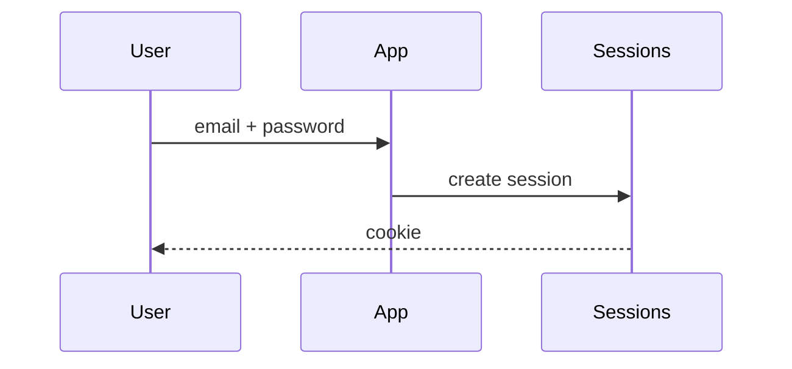

# Login

Users sign in with their email address and a password. After five failed attempts the account is locked for fifteen minutes. Sign-in with a Google account is supported through OAuth.

## Flow

See [[produit/password-reset]] when a user forgot the password, and [[tech/adr-0001-jwt-sessions#Decision]] for why sessions are signed tokens.
