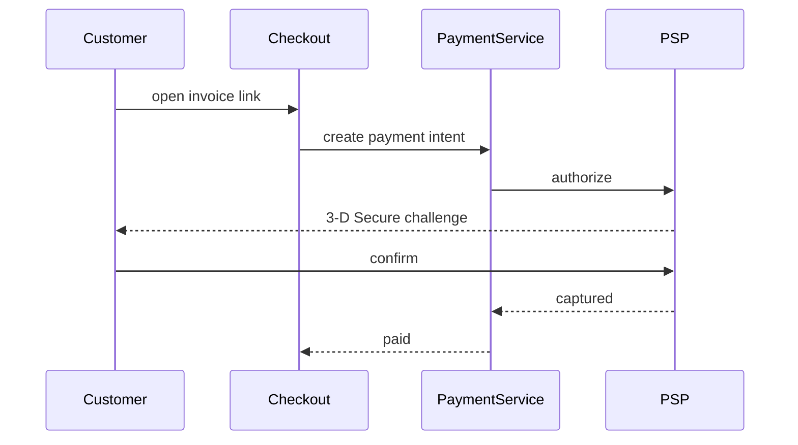

# Hosted checkout

Every invoice email links to a hosted page where the customer pays. No login: the link carries a signed, single-invoice token. The page shows the invoice, the amount due, and the payment methods that make sense for the currency (see [[produit/multi-currency]]).

## Flow

## Details

- The payment intent is created once per page load and reused on retry, see [[tech/idempotency]].
- If the customer closes the tab during 3-D Secure, the intent stays pending for 30 minutes. If it fails, [[produit/payment-retries]] takes over for subscriptions.
- A receipt is sent through [[produit/notifications]].

> [!note] Safari autofill
> Safari 17 filled the card number into the wrong field, which broke the form for a week. Fixed in [[gh:acme/app#23]].
