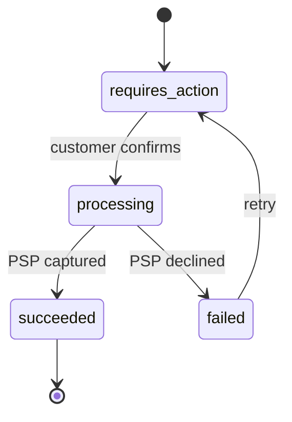

# Payment service

The payment service owns payment intents: it creates them, talks to the PSP through [[tech/psp-integration]], and posts the result to the [[tech/ledger]]. It is the only service allowed to move money.

## State machine

## Guarantees

- Every call that creates or confirms an intent carries an idempotency key, see [[tech/idempotency]].
- A state change and the event announcing it are written in one transaction ([[tech/adr-0005-transactional-outbox]]).
- The PSP is called outside any database transaction. If the call times out, a reconciliation job asks the PSP for the real outcome before anything is retried.

## Latency budget

p95 under 800 ms for create, under 3 s for confirm, dominated by the PSP. Dashboards and alerts are described in [[tech/observability]].
